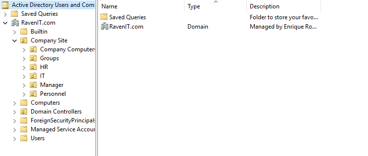

## Background
The small business will be named RavenIT.com using Windows server 2016 as DNS. The Hostname is:
ADMINGUY  <!--(I know its a bad name to reference a server for other computers to access a Shared Drive, but that will be renamed later 11/12/2026) -->

## Departments
The business will contain 4 Departments for users they belong to:
--- 2-3 departments will be added later: Finance/Sales and Customer (11/12/2026)
--- I wanted to simulate of moving users to another OU, change GPO, and "fix" issues users might encounter

| Department | Description |
|-----:|---------------|
|  IT  |   Helpdesk Tier I and II level            |
|  HR  |     Human Resources handling sensitive Personnel Documents, file, and personal accounts          |
|  Manager |        Managing RavenIT company Personnel       |
| Personnel | Basic Team Members or Corporate workers  |

<picture>
 
</picture>

## DNS 
