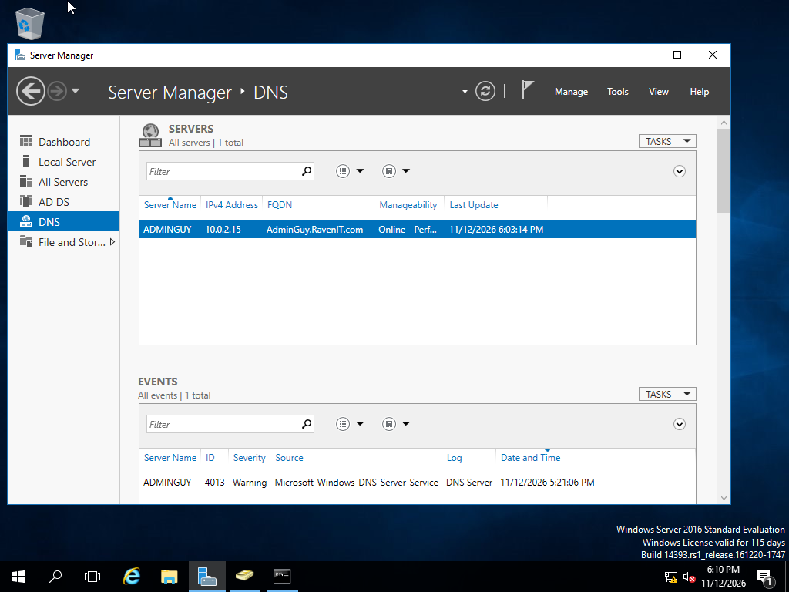
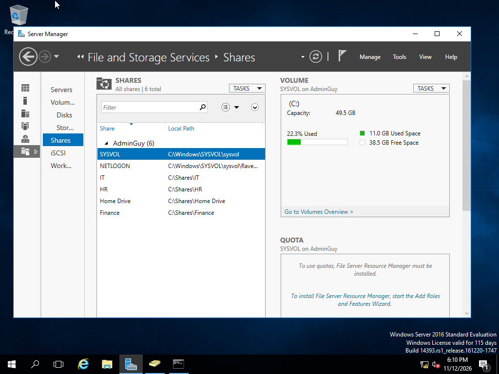

## Background
RavenIT.com started out as a 20+ personnel/workers started in Dallas Texas. The company itself wanted to operate at a small-medium business level. 
Later on in this documentation, the company will add more users, departments, and managing accounts as well Group Policy by permissions, administrative access, mapped network drives, and
more 
>(Self: Depending how far if I go Tier I and II IT Support )
>(Self: When I say this business run small-medium business level. I wont strain my physical PC resources when doing this lab

## Departments
---
A typical small business might consist below this table are:

| Department | Description |
|-----:|---------------|
|  IT  |   Helpdesk Tier I and II level            |
|  HR  |     Human Resources handling sensitive Personnel Documents, file, and personal accounts          |
|  Manager |        Managing RavenIT company Personnel       |
| Personnel | Basic Team Members or Corporate workers  |

>2-3 departments will be added later: Finance/Sales and Customer (11/12/2026)
>I wanted to simulate of moving users to another OU, change GPO, and "fix" issues users might encounter
--- 
<picture>
 
</picture>

## DNS 
The DNS will be static IP address. Otherwise, the DHCP will be turned on by default. Causing VM Computers having invalid IP addressing issues with no way to update DNS IP changes from DHCP.

<picture>
 
</picture>

## Folder Shares / Mapped Drives
Each Department will have their own folders with permissions they can read, write, access, and delete.
Admins and IT Support can access every folder for diagnosing, moving users, or offboarding users off folder access.

<picture>
 
</picture>
